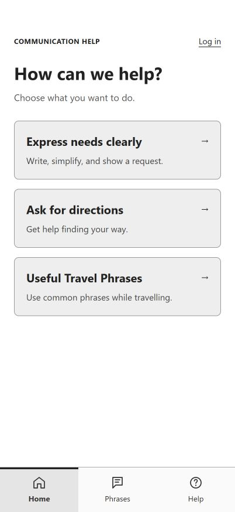
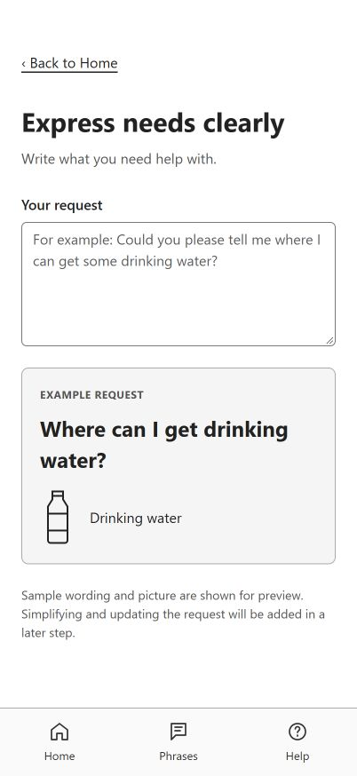
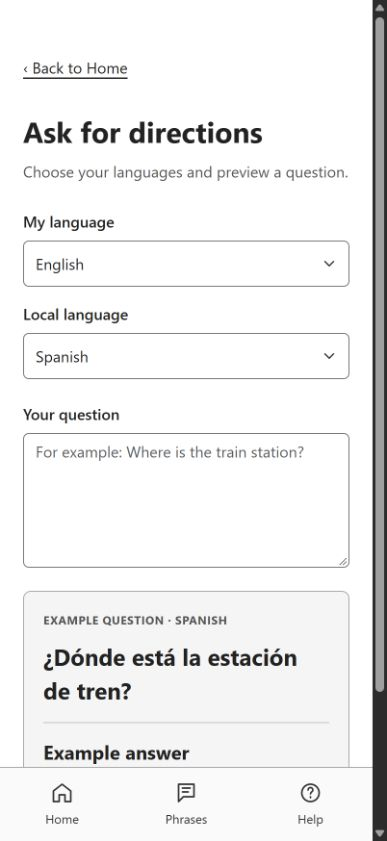

# Lab 6 — Surkhab: Bootstrap and navigation

The homepage now opens Express Needs, Directions, and Useful Travel Phrases. All six app pages share the Home / Phrases / Help navigation and match the grayscale Figma layout.

## Run and review

Run `npm ci` and `npm run dev`. For the existing authentication pages, copy `.env_template` to `.env` and use the team's Firebase settings. The app preview pages do not require Firebase.

Run `npm run build` and `npm run preview` to check the production version. The Vite configuration includes the six app pages plus the existing `login.html` and `main.html` entries.

## Contribution

- Added Bootstrap from the existing dependency and kept custom app styles in `styles/style.css`.
- Connected the three Home cards and added Express Needs, Directions, Travel Phrases, Frequently used Phrases, and Help pages.
- Added one shared navigation component with labelled SVG icons, an active-page indicator, keyboard focus styles, and a skip link.
- Added Back to Home links, category anchors, and links from frequently used requests to their relevant previews.
- Preserved the existing authentication pages, scripts, redirects, and components without edits.

This is a page-layout and navigation contribution. Request rewriting, live translation, saving, database access, and feature-specific button listeners remain future work. Example text does not change when form values change.

## Validation

- Production build passed with all eight HTML entries.
- Clicked all 32 cross-page links, including every shared navigation link, Back to Home link, Home task card, Help route link, and sample-phrase link.
- Emergency and Back to categories anchors passed.
- All six pages fit at 402 × 874, at 320 × 740, and on a 1440 × 900 desktop viewport without horizontal overflow.
- The existing login page opens from Home. Login/sign-up switching and blank-form validation passed with the team's local Firebase configuration. No real account was created or signed into; live Firebase authentication was not end-to-end tested.
- Authentication files have no changes relative to the starting `develop` commit.

## Hand-in screenshots

### Home

Works: Bootstrap layout, all three route cards, Log in, and Home / Phrases / Help links. Incomplete: the task routes use sample content rather than live services. Supports the shared layout and homepage-navigation tasks.

### Express Needs

Works: labelled request field, sample wording and water-bottle visual, Back to Home, and shared navigation. Incomplete: simplifying wording, selecting a picture, and updating the request preview. Supports the placeholder-page and navigation tasks.

### Directions

Works: language selectors, question field, sample Spanish question and English answer, Back to Home, and shared navigation. Incomplete: live translation and listening. Supports the placeholder-page and navigation tasks.

Additional captures: [Travel Phrases](lab06/screenshots/travel-phrases-402x874.png), [Frequently used Phrases](lab06/screenshots/phrases-402x874.png), and [Help](lab06/screenshots/help-402x874.png).

## Team review

Review and merge the pull request into `develop` through the team's normal GitFlow process. Zamin can attach feature-specific IDs and listeners to these pages in a separate branch. Record the actual assisted session time separately from the four-hour planning estimate; do not report the estimate as time worked.
